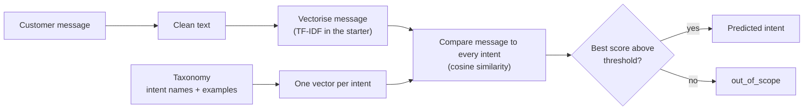
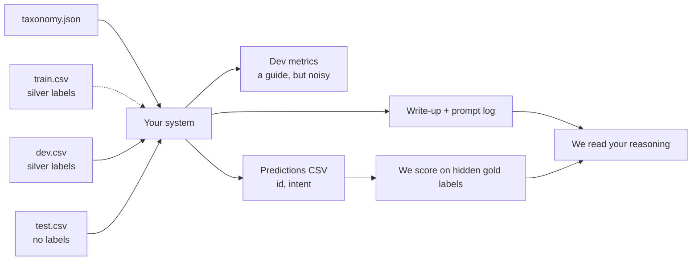

# QuickCart intent task

Welcome. This is a take-home task for the Applied ML Intern role on the Yellow.ai Research Team. Everything here is synthetic and fictional.

## The situation

QuickCart is a made-up food-delivery and grocery app. Its support chatbot reads a customer message and picks one of 12 intents by matching the message against a hard-coded **intent taxonomy** (intent names plus a few example messages each). The current matcher is a deliberately simple starter, and the system around it has problems.

Your job is to **improve the whole system** and show, with evidence, what was wrong and what helped. That includes the taxonomy, the data, the evaluation, and the model. A single accuracy number is not the goal. How deep you go and how honestly you report is.

**Scope:** this task is only about optimising **intent extraction** (deciding which of the 12 intents a message belongs to). Entity extraction, response generation, dialogue flow and UI are out of scope.

## How the starter works



And how your work is evaluated:



## What you get

```
data/
  taxonomy.json   the hard-coded taxonomy: 12 intents, a few examples each
  train.csv       30,000 rows: intent, utterance   (silver labels)
  dev.csv          4,000 rows: intent, utterance   (silver labels)
  test.csv         3,000 rows: id, utterance       (labels are hidden)
baseline/
  baseline.py     taxonomy matcher: TF-IDF centroid per intent, cosine, threshold
  eval.py         evaluation on dev -> results/baseline_dev.json
results/          baseline numbers
submissions/      submission format + a format example
```

Setup (Python 3.10+):

```
python -m venv .venv && source .venv/bin/activate
pip install -r requirements.txt
python -m baseline.eval          # dev numbers, ~10 seconds
python -m baseline.baseline      # writes submissions/baseline_predictions.csv
```

## Baseline approach and results

**Approach (TF-IDF):** each intent is represented by the average TF-IDF vector of its taxonomy examples. A message is scored by cosine similarity to every intent. The best-scoring intent wins, unless the best score falls below a fixed threshold, in which case the message is labelled `out_of_scope`. The taxonomy examples are the only labelled signal it uses. It does not learn from `train.csv`.

**Results the starter reports on dev (4,000 rows, silver labels):**

| Metric | Value |
|---|---|
| Top-1 accuracy | 0.423 |
| Top-3 accuracy | 0.719 |
| MRR | 0.665 |

Per-class numbers and the confusion matrix are in `results/baseline_dev.json`. Treat all of these as the starting point you are trying to beat, not as numbers to trust. Dev labels are silver, and you should check the evaluation code as carefully as the model.

## Read this about the data

- **Labels in `train.csv` and `dev.csv` are silver, not gold.** They were produced by an automatic process and contain errors. Assume some labels are wrong, and that the errors are not random. Measuring this is part of the task.
- `test.csv` has hidden gold labels that follow the rules below. You will not see them.
- Messages are noisy on purpose: typos, abbreviations, emojis, Hinglish (mixed Hindi and English), long rambling messages, and messages that ask for more than one thing.
- The taxonomy has deliberate flaws and overlaps. Some intents are close to each other. Do not assume the starter taxonomy, the starter code, or the starter numbers are correct.

## How the hidden test labels are decided

1. Each message gets exactly one label, the intent for the action the customer wants done. If a message asks for several things, the first one asked is the primary request and decides the label. Example: "where is my order, and also I want a refund" is `order_status`, because the first thing asked is the order's status. Rules 2 and 5 below are the exceptions.
2. If the customer changes their mind, the last request wins ("cancel it... actually never mind, where is it?" is `order_status`).
3. Cancel plus refund: an order not yet delivered is `cancel_order`, a delivered one is `refund_request`.
4. A complaint with no request is labelled by the problem: late is `delivery_delay`, something absent is `missing_item`, something different is `wrong_item`.
5. Asking only for a human or escalation is `talk_to_agent`. If another request is also present, the other request wins.
6. Anything not about QuickCart orders, accounts or payments is `out_of_scope`. That includes small talk, gibberish, other companies' services, and services QuickCart does not offer (for example gift cards, loyalty points, tax invoices, tipping riders, restaurant feedback). A greeting or thanks alone is `out_of_scope`. A greeting plus a real request takes the request's label.
7. Filler, emotion and unrelated detail never change the label.
8. Order IDs, amounts and item names never change the label.

## What to do

There is no single right path. A strong submission usually covers:

- **Find and quantify problems.** Read real errors, group them, count them. Check the taxonomy, the labels, the evaluation code and the baseline code.
- **Improve the system.** Fix what you find. Show before and after numbers on dev (and be clear about how dev can mislead you).
- **Make choices with evidence.** If you pick a model, a representation, or a threshold, show the data that backed the choice. "It is popular" is not evidence.
- **Report honestly.** Say what did not work and what you could not verify.

Finding bugs in the starter code and quantifying their effect, and proposing concrete next steps with numbers, counts as much as accuracy.

## Compute budget

**Your final system must fit a production ceiling of 4 CPU cores and 15 GB RAM.** Assume that is the machine it will run on, answering messages one at a time in real time.

- You may use a GPU (or any other compute) while you experiment, train or label. That is fine.
- But whatever you propose as the final system has to be runnable within the 4-core, 15 GB budget at inference time. State clearly what runs where.
- Report the latency per message you measured, on what hardware, and your estimate for the 4-core, 15 GB box.
- Hosted APIs that serve open-source models are allowed. Say which you used, what for, and what that would mean in production (cost, latency, reliability). Do not send anything that is not in this repo.
- Fine-tuning is allowed, but treat it as a small part of the story, not the main one.

## Ground rules

- **The use of AI tools is encouraged. Open-source tools are encouraged.** You must be able to explain every line you submit and where an AI tool got something wrong.
- Do not edit `test.csv`. Do not train on test. You have no test labels, so do not try to infer them.
- Expected effort is **4 to 6 hours spread over the window**. Nobody needs an all-nighter. A smaller, well-evidenced result beats a large unfocused one.
- **Questions or clarifications about anything in this task:** reach out to Abhivanth directly, on the channel you received this task on. Asking is fine and does not count against you.

## Hints and insights

These are starting points, not instructions. We have not verified them, so check quality, licenses and cost yourself.

- Look at what the matcher actually knows about each intent. Would that be enough for a new human agent to tell two similar intents apart? What would you add to help them?
- Two intents have nothing to match against in the taxonomy. What does that tell you about the baseline, and how could you still serve them?
- A bot answers in real time, on a small machine. Think about which kinds of models respond in a few milliseconds on four cores, what you gain and give up with them compared with slower, heavier ones, and where each belongs in a system.
- When a model and a label disagree, either could be the one that is wrong. Look at a sample of the disagreements before you decide which.
- The taxonomy examples and the data were not created independently. Check how they relate before you trust a score.
- Accuracy hides a lot. Break results down by class, by message length, by language mix and by how many requests a message makes.
- Sentence-embedding models are one route. People use small MiniLM-style, BGE-small, E5-small and multilingual models. Compare options on this data, and report latency too.
- Measure how close intents are to each other (distances between intent representations) and relate that to your confusion matrix.
- The "unknown" decision is a model of its own. How would you set and test it?
- Estimate label noise, for example by cross-validated disagreement or a manual audit of a sample with a confidence interval.
- Use the training data, not only the taxonomy examples, and compare the two under the same compute.
- Optional: handle Hinglish more deliberately. Quality beats breadth, one thing done well is enough.

## What to submit

By **EOD Nov 9**, send the person who gave you this task:

1. A link to your GitHub repo (or a zip) with your code and a clear commit history.
2. `submissions/<your_name>_predictions.csv` in the format described in `submissions/README.md`.
3. A write-up, **maximum 2 pages**, covering: the biggest problems you found, what you changed with before and after numbers, what you tried that did not work, the limits of your evaluation, your latency and compute notes against the 4-core, 15 GB budget, and what you would do next.
4. **Your findings, benchmarks and results as CSVs or simple tables** (for example in a `results/` folder in your repo, and summarised in the write-up). Make them easy to read: one row per experiment or per class, clear column names, and a before and after comparison wherever you changed something. How clearly you communicate your results is part of how we judge the work.
5. A **prompt log** (`prompt_log.md` in your repo, or an exported chat history): every prompt you gave AI tools for this task, in order, with a one-line note on what you did with the answer. Mark answers that were wrong or that you rejected. Do not tidy it up. We read it to understand how you work, not to catch you out.

## What happens next

We score your predictions on the hidden test set (per-class precision, recall and F1, macro-F1, accuracy) and read your write-up, prompt log and code. The score is one signal. The reasoning behind it matters more. Candidates who submit will get a 20 to 30 minute discussion on **Nov 10** about their work. Final results go out at the end of next week.
